<p align="center">
  
</p>

<p align="center">
  
  
  
  
</p>

```yaml
handle:   maapik
track:    Информационная безопасность в правоохранительной системе (РТУ МИРЭА)
focus:    Компьютерная экспертиза (DFIR), Incident Response & Reverse Engineering
goal:     Разбор реальных инцидентов, артефактов ОС и бинарного анализа от CTF до прода
```

Собираю здесь свои расследования, лабораторные работы, CTF-врайтапы и pet-проекты. Копаюсь в журналах событий Windows, файловой системе NTFS, фишинговых кампаниях и декомпилированном коде.

---

## 🛠️ Арсенал и инструменты

<p>
  <strong>DFIR &amp; Incident Response</strong><br />
  
  
  
  
  
  
</p>

<p>
  <strong>Reverse Engineering &amp; CTF</strong><br />
  
  
  
  
  
</p>

<p>
  <strong>Dev &amp; Infrastructure</strong><br />
  
  
  
  
  
</p>

---

## 📂 Репозитории

| Проект | Описание | Стек |
| :--- | :--- | :--- |
| 🔍 **[cybersec-writeups](https://github.com/maapik/cybersec-writeups)** | Архив расследований (DFIR / IR), реверс-инжиниринга, OSINT-отчётов и Web CTF разборов | `DFIR` `EVTX` `$MFT` `IDA Pro` `CTF` |
| 💳 **[FinanceTracker](https://github.com/maapik/FinanceTracker)** | Веб-приложение для учёта личных финансов с персистентной БД в контейнере | `C#` `.NET 8` `Blazor` `SQLite` `Docker` |

---

## 🎯 Избранные разборы (Featured Cases)

| Направление | Кейс | Что внутри |
| :--- | :--- | :--- |
| `DFIR` | **[RomCom — WinRAR `CVE-2025-8088`](https://github.com/maapik/cybersec-writeups/blob/main/dfir-ir/htb-sherlocks/romcom-winrar-cve-2025-8088.md)** | Разбор `$MFT` и `$J` через `MFTECmd` и `Timeline Explorer`, фиксация `ObjectIdChange`, поиск бэкдора и автозапуска `T1547.009` |
| `IR / EVTX` | **[Operation Blackout 2025: Smoke & Mirrors](https://github.com/maapik/cybersec-writeups/blob/main/dfir-ir/htb-sherlocks/operation-blackout-smoke-and-mirrors.md)** + **[Anti-VM](https://github.com/maapik/cybersec-writeups/blob/main/dfir-ir/htb-sherlocks/operation-blackout-anti-vm.md)** | Расследование отключения LSA Protection и Defender, патч `AmsiScanBuffer`, детекция `Check-VM` (Nishang) в PowerShell `.evtx` |
| `Forensics` | **[Лаба №1 (РТУ МИРЭА): Инцидент на Windows Server](https://github.com/maapik/cybersec-writeups/blob/main/dfir-ir/university-mirea/lab-01-windows-server-incident.md)** | Построение таймлайна заражения и установление причастности по `System.evtx` (Event ID `7045`), `Security.evtx` и SID |
| `Reverse` | **[FlagCasino (Hack The Box)](https://github.com/maapik/cybersec-writeups/blob/main/reverse-engineering/htb/flag-casino.md)** | Статический анализ ELF в IDA Pro (`F5`), эксплуатация предсказуемого `srand()`/`rand()` через Python `ctypes` + `pwntools` |
| `Threat Intel` | **[Operation Dream Job-2 — APT Lazarus](https://github.com/maapik/cybersec-writeups/blob/main/dfir-ir/htb-sherlocks/dream-job-2-lazarus.md)** | Маппинг по MITRE ATT&CK, анализ ISO/PE (`isoinfo`, `exiftool`, `pescan`) и декомпиляция p-code при VBA Stomping (`pcode2code`) |

---

<p align="center">
  
</p>
